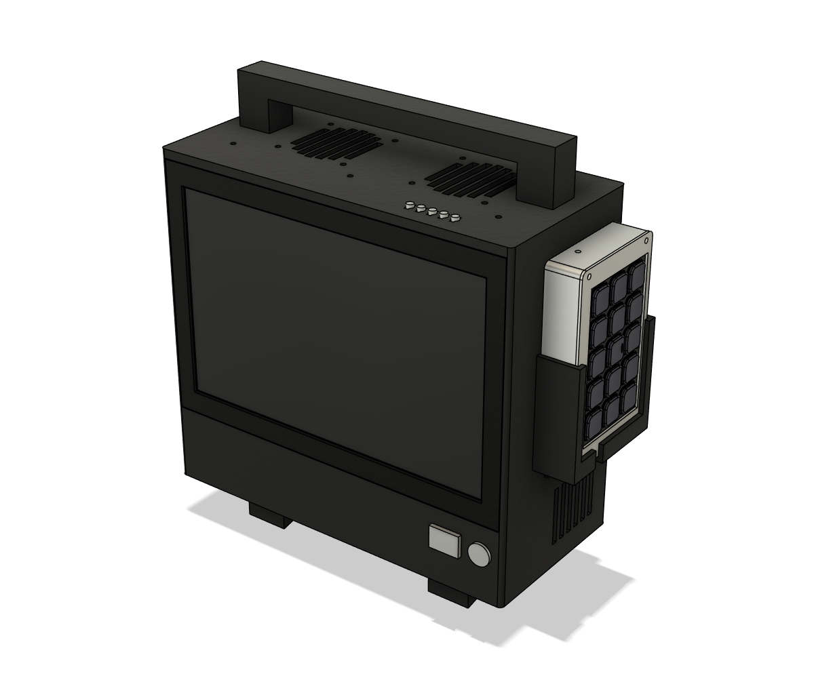
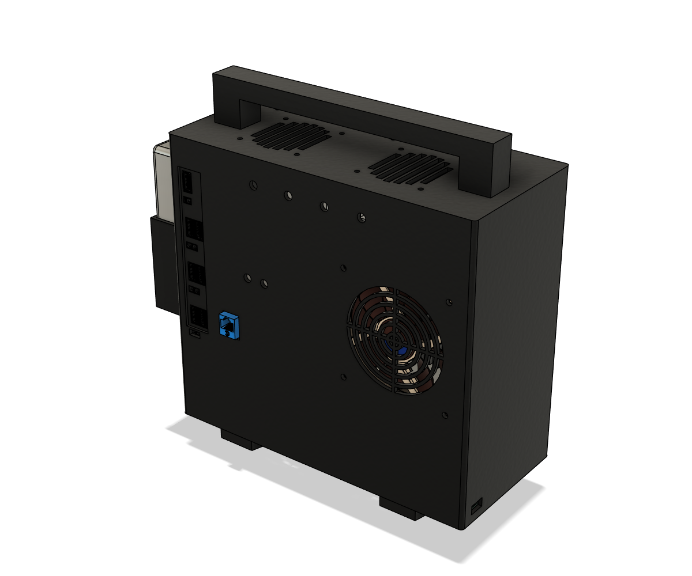
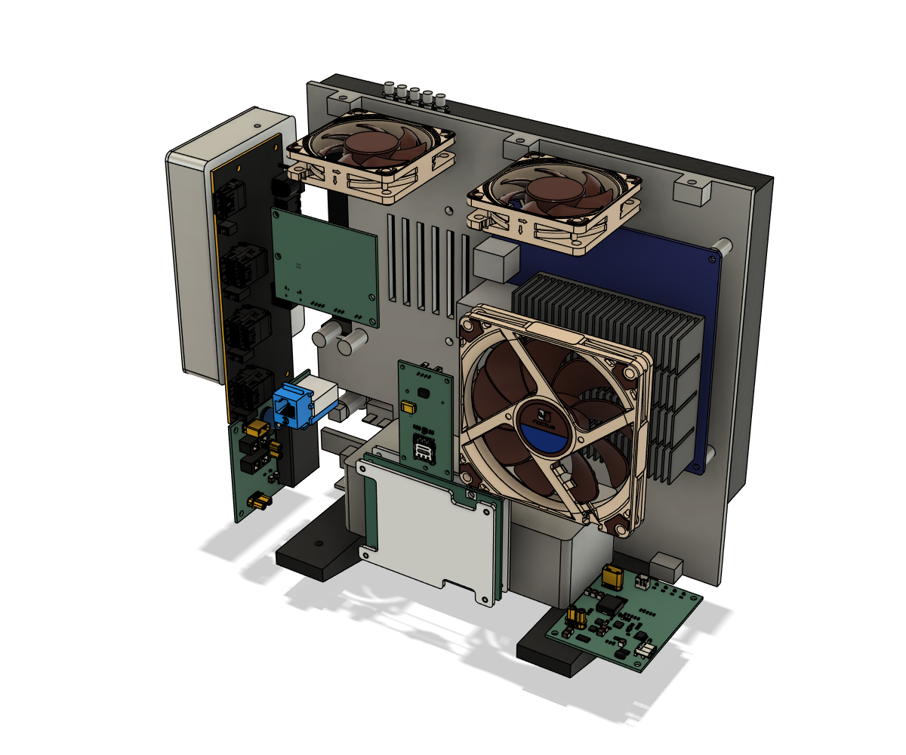
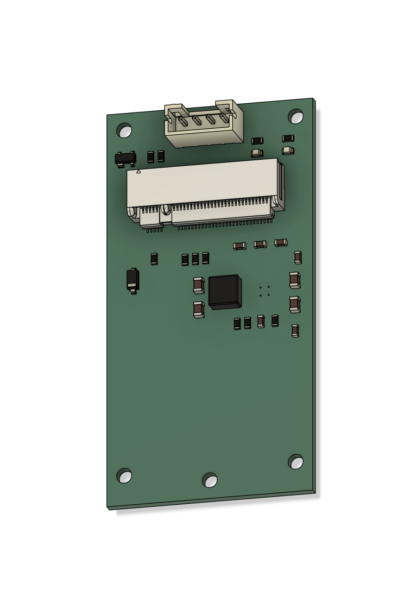
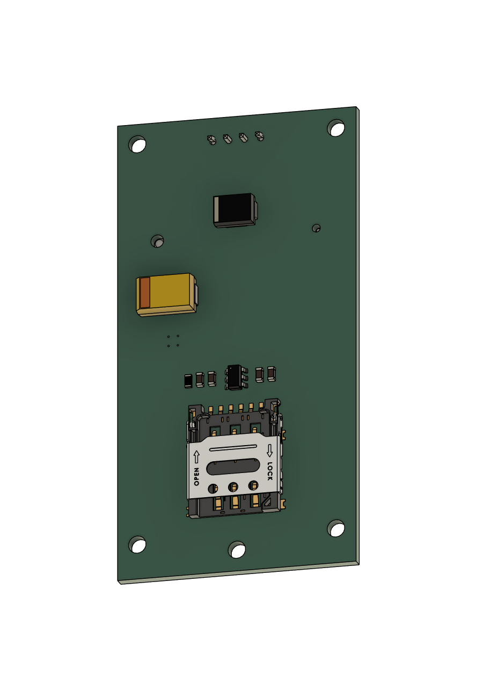

# Bench Box V2

A portable, battery-powered workstation built around an **ODROID-H5** and a **10.1" touchscreen** in a 3D-printed
case with a carry handle. Think of it as a chunky, repairable laptop: USB-C charging, about 3 hours on its own battery,
a 7-port USB 3 hub, WiFi 6E, optional LTE, and a dock for an Elgato Stream Deck module.



It was made for developing car infotainment systems on the bench (it runs the same x86 computer the car does), but
nothing in it is car-specific: it is a general-purpose Windows or Linux PC.

| | |
|---|---|
| Computer | ODROID-H5 (Intel Core i3-N300, 8 cores), 16 GB DDR5, NVMe SSD |
| Screen | 10.1" 1280 x 800 IPS touchscreen, flush in the front frame |
| Battery | 14.8 V 6.6 Ah LiPo (~98 Wh) with a smart BMS; ~3 h at a typical 30 W |
| Charging | USB-C PD (60 W+ charger; 100 W for the fastest charge), runs while charging, no break when unplugged |
| USB | 7 x USB 3.2 on the back (hub), plus header ports used inside for the Stream Deck and battery readout |
| Network | Ethernet on a keystone jack in the back wall |
| Wireless | WiFi 6E + Bluetooth (Intel AX210); optional LTE Cat 6 (Quectel EM060K); optional Bluetooth hands-free board (calls, phone book, phone audio) |
| Cooling | 3 Noctua fans (one in, two out), on the H5's own fan control |
| Size | about 280 x 227 x 116 mm (W x H x D, Stream Deck dock included) + 36 mm handle |
| Weight | about 2.7 kg (estimate) |

> ## Status: read this first
>
> **The design is complete, but this exact version has not been built yet.** The first version of the box (same
> computer, screen, fans and mounting, mains-powered) was printed and works. Version 2 adds the battery, the custom
> charger and converter boards, a new hub and a new shell; its parts have been checked against each other in CAD
> (no collisions) but not printed or wired up. The custom boards are designed and checked against their datasheets,
> not yet built; they will be available from the builder, assembled (price to be announced). This page will be updated
> as the first V2 is built.
>
> **Lithium safety**: the pack is a large LiPo with no protection of its own. Never connect it without the BMS, keep
> it in a fireproof LiPo sleeve, charge it where you can watch it until you trust the build, and test new boards on a
> current-limited bench supply first.

## Pictures (CAD)

| Back | Inside (shell hidden, from behind) |
|---|---|
|  |  |

## What's here

| Folder | What |
|---|---|
| [`print/`](print) | **Slicer-ready `.3mf` files**, one per print job, parts already laid flat |
| [`stl/`](stl) | the same parts as STL, in their assembled positions (GitHub shows them in 3D) |
| [`bom.csv`](bom.csv) | the parts list below as a spreadsheet |
| [`wiring/`](wiring) | wiring poster (`bench-box-v2-poster.png` / `.pdf`) and wire-by-wire sheets (open `index.html`; `wirelist.csv` lists every lead) |
| [`images/`](images) | the pictures on this page |

## Bill of materials

**Roughly $1,350 for the core build's bought parts** (estimate, without the screen's price, which varies, and without
the custom boards, whose price is to be announced), plus about $140 for the Stream Deck dock and $150 for LTE. Prices are approximate (USD, November 2026) and change; links are to the maker or a major seller. "x2" etc. is how
many the box uses.

### Computer

| Part | Qty | For | Price | Notes |
|---|---|---|---|---|
| [Hardkernel ODROID-H5](https://www.hardkernel.com/shop/odroid-h5/) | 1 | the computer | $230 | no power adapter needed; ships from Korea |
| [16 GB DDR5 SODIMM (Corsair CMSX16GX5M1A5600C48)](https://www.centralcomputer.com/corsair-cmsx16gx5m1a5600c48-16gb-16gbx1-ddr5-so-dimm-laptop-memory.html) | 1 | RAM | ~$220-250 | any single DDR5 SODIMM works; runs at 4800 |
| [M.2 2280 NVMe SSD (SanDisk Optimus 5100 500 GB)](https://www.cdw.com/product/sandisk-optimus-5100-ssd-500-gb-pcie-4.0-x4-nvme/9205163) | 1 | storage, slot M2_SSD1 | ~$118 | any M.2 2280 NVMe |
| [Intel AX210NGW WiFi 6E + Bluetooth card](https://www.amazon.com/dp/B08MJLPZPL) | 1 | WiFi | ~$20-25 |  |
| [M.2 M-key to A/E-key adapter (HighZer0)](https://www.amazon.com/dp/B0BGCWQY67) | 1 | puts the AX210 in slot M2_SSD4 | ~$12-15 | the H5 has only M-key slots |
| [Tenmory WiFi 6E antenna kit (2 RP-SMA antennas + 2 MHF4 pigtails)](https://www.amazon.com/dp/B07QDZKH5N) | 1 | WiFi antennas | ~$15 | pigtails go to the back-wall WiFi holes |

### Screen and controls

| Part | Qty | For | Price | Notes |
|---|---|---|---|---|
| [VIEWMEI 10.1" 1280 x 800 USB-C touchscreen](https://www.amazon.com/dp/B0GCNXNZ17) | 1 | main screen | check listing | the frame is sized to this screen: 245.5 x 168.75 x 21.5 mm, 75 mm VESA (M4). Check the size before buying |
| [12 mm momentary metal push button, 5 V ring LED](https://www.amazon.com/s?k=12mm+momentary+metal+push+button+5V+ring+LED) | 1 | power button | ~$5-8 | 11.75 mm hole; NO contacts + LED |
| [KCD1 rocker switch, 20 A (Dopkiut, 10-pack)](https://www.amazon.com/dp/B0HCZ5X637) | 1 | master power switch | $6 | 19.2 x 12.7 mm cut-out |

### Battery and charging

| Part | Qty | For | Price | Notes |
|---|---|---|---|---|
| [Liperior Endurance 6600 mAh 4S2P LiPo (LPD66004S150)](https://rcbattery.com/liperior-endurance-6600mah-4s2p-150c-14-8v-speed-runs-lipo-battery.html) | 1 | the pack, ~98 Wh | $69.99 | 135 x 54 x 42 mm, bare 7 AWG leads, no protection of its own |
| [JBD SP04S010A smart BMS, 4S, NMC / Li-ion version, 20 A or 30 A](https://jbdbms.com/products/sp04s010a) | 1 | protection and balancing | ~$17.50 | pick the NMC (Li-ion) 4S version; add the Bluetooth module for the phone app |
| [LiPo safety bag (DerBlue, 185 x 75 x 60 mm)](https://www.amazon.com/dp/B01GCHBQJS) | 1 | fire sleeve round the pack | ~$8-10 |  |
| [Inline ATC/ATO fuse holder, 14 AWG, + 10 A fuse](https://www.amazon.com/s?k=inline+ATC+fuse+holder+14+AWG) | 1 | pack + lead | ~$6 |  |
| [Semitec 103AT-2 10 k NTC thermistor](https://www.digikey.com/en/products/result?keywords=103AT-2) | 1 | pack temperature for the charger | $0.68 | tape it to the pack |
| [JST PH 2-pin pigtails (pack of 10)](https://www.amazon.com/s?k=JST+PH+2.0+2+pin+pigtail) | 1 | NTC to charger J4 | ~$6 |  |
| [Amass XT30-U connector pairs (5 pairs)](https://www.getfpv.com/amass-xt30-u-lipo-connector-set-5-pairs.html) | 1 | all power leads | ~$8 |  |
| [100 W USB-C PD charger (Anker Prime 100 W or UGREEN Nexode 100 W)](https://www.amazon.com/dp/B0963HDMJP) | 1 | charges and runs the box | ~$50-70 | any USB-C PD charger with 20 V; 60 W minimum |
| [USB-C cable, 5 A e-marked (Anker 100 W)](https://www.amazon.com/dp/B072JYDQ7N) | 1 | charger to box | ~$15-20 | needed for the 100 W setting (JP1 cut) |

### Custom boards (from the builder)

Designed for this box and sold assembled by the builder; prices are to be announced. What each board does and how it
connects: [Custom boards](#custom-boards) below.

| Part | Qty | For | Price | Notes |
|---|---|---|---|---|
| Charger board | 1 | USB-C in, charging, power path | TBD | from the builder |
| Converter board | 1 | fuses + 12 V for the H5 | TBD | from the builder; fuses not included (below) |
| [Littelfuse 0297010.WXNV MINI blade fuse, 10 A](https://www.digikey.com/en/products/result?keywords=0297010.WXNV) | 1+ | converter board F2 | $0.39 | buy spares |
| [Littelfuse 0297005.WXNV MINI blade fuse, 5 A](https://www.digikey.com/en/products/result?keywords=0297005.WXNV) | 1+ | converter board F1 | $0.39 | buy spares |

### USB and cables

| Part | Qty | For | Price | Notes |
|---|---|---|---|---|
| [Coolgear CG-7PU31HB-PCBA 7-port USB 3.2 hub board](https://www.digikey.com/en/products/detail/coolgear/CG-7PU31HB-PCBA/16720388) | 1 | USB ports on the back | $146.70 |  |
| [HDMI, 1 ft, 90 degree plug](https://www.amazon.com/dp/B06Y69TCTW) | 1 | H5 to screen | ~$8-10 |  |
| [USB-A to USB-C, 1 ft, right-angle (2-pack)](https://www.amazon.com/dp/B0784F9JP2) | 1 | H5 USB 2.0 port to screen (power + touch) | ~$8 |  |
| [USB 3.0 A to B, 1 ft, right-angle](https://www.amazon.com/dp/B07SR71Q67) | 1 | H5 to hub | ~$8-10 |  |
| [18 AWG pigtail, 5.5 x 2.1 mm male barrel (3-pack)](https://www.amazon.com/dp/B0DGQS55NG) | 1 | converter 12 V to the H5 | $6.99 | fit an XT30 male on the free end |
| [DSD TECH SH-U09C3 isolated USB-serial adapter](https://www.amazon.com/dp/B07TS3GPQ1) | 1 | battery readout (BMS UART) | ~$15 | set its jumper to 3.3 V |
| [Cat6 UTP punch-down keystone jack](https://www.amazon.com/s?k=cat6+utp+punch+down+keystone+jack) | 1 | Ethernet port in the back wall | ~$5 | standard keystone (14.9 x 19.4 mm opening); unshielded |
| [Cat6 patch cable, 1 ft](https://www.amazon.com/s?k=cat6+patch+cable+1+ft) | 1 | H5 to the keystone jack | ~$5 | far end cut off and punched down on the jack |
| [Short USB-A male to female extension](https://www.amazon.com/s?k=short+USB+A+extension+cable) | 1 | cut and crimped to header port P5 for the adapter | ~$5 |  |

### Cooling

| Part | Qty | For | Price | Notes |
|---|---|---|---|---|
| [Noctua NF-A9x14 PWM](https://www.amazon.com/dp/B009NQM7V2) | 1 | intake, back wall | $18.95 |  |
| [Noctua NF-A6x15 PWM (12 V version)](https://www.amazon.com/dp/B0DJNX4CX4) | 2 | exhaust, top | $16.95 each | not the 5 V version |
| [Noctua 3-way 4-pin PWM splitter (NA-SC1)](https://www.amazon.com/dp/B0DJPBXZ89) | 1 | three fans on the H5 fan header | ~$10 |  |

### Screws, inserts, small parts

| Part | Qty | For | Price | Notes |
|---|---|---|---|---|
| [ruthex M3 heat-set inserts (100)](https://www.amazon.com/dp/B08BCRZZS3) | 33 used (37 with the Bluetooth board) | all M3 mounts | $9.99 | 4.0 mm holes as printed |
| [ruthex M2 heat-set inserts](https://www.amazon.com/dp/B088QJG676) | 8 used | BMS + modem | ~$9-10 |  |
| [M3 button-head screw kit (Besitu, 6-35 mm)](https://www.amazon.com/dp/B0D1KQCBMT) | 1 | M3 x 6 (8), x 8 (17, +4 for the Bluetooth board), x 10 (8) | $21.99 | button heads: the holes have no countersinks |
| [M4 x 8 button-head screws](https://www.amazon.com/dp/B0FGX64FW2) | 4 | screen VESA | ~$21 (kit) | check the screen's thread depth first |
| [M2 screws: 4 x M2 x 6 + 4 long (length to suit the BMS)](https://www.amazon.com/s?k=M2+button+head+screw+kit) | 8 | modem board, BMS | ~$10 | BMS screws go through cover, board and base plate |
| [Hook-and-loop straps, 20 mm wide](https://www.amazon.com/s?k=20mm+hook+and+loop+battery+strap) | 2 | hold the pack | ~$7 |  |
| [Stick-on rubber feet](https://www.amazon.com/dp/B07PWCC6KP) | 4 | under the feet | $7.99 |  |

### Wire and connectors

| Part | Qty | For | Price | Notes |
|---|---|---|---|---|
| [14 AWG silicone wire, red + black](https://www.amazon.com/s?k=14+awg+silicone+wire+red+black) | 1 | battery path | ~$12 |  |
| [18 AWG silicone pair, tinned copper (BNTECHGO)](https://www.amazon.com/dp/B0779QRR58) | 1 | hub and 12 V leads | $14.83 |  |
| [Dupont crimp kit (housings + pins + crimper)](https://www.amazon.com/s?k=dupont+crimp+kit) | 1 | header connections | ~$25 |  |
| [Heat-shrink kit](https://www.amazon.com/dp/B0C81FHPHN) | 1 | every joint | $9.99 |  |

### Printing

| Part | Qty | For | Price | Notes |
|---|---|---|---|---|
| [ASA or ABS filament, 1 kg](https://www.amazon.com/s?k=ASA+filament+1kg) | 1 | all printed parts | ~$25 | PETG for a desk-only box |

### Optional: Stream Deck dock

| Part | Qty | For | Price | Notes |
|---|---|---|---|---|
| [Elgato Stream Deck Module 15 Keys (10GBT9901)](https://www.elgato.com/us/en/p/stream-deck-module-15-keys) | 1 | 15 LCD keys, docked on the right wall | $129.99 | case: print/5-stream-deck-case.3mf + 4 x M3 x 6 and 4 inserts |
| [Coiled USB-C to USB-A cable (Cable Matters 4 ft)](https://cablematters.com/pc-1678-123-coiled-usb-c-to-usb-a-charging-cable-4ft.aspx) | 1 | Stream Deck to header port P7 | ~$10-13 | USB-A end cut off and crimped |

### Optional: LTE

| Part | Qty | For | Price | Notes |
|---|---|---|---|---|
| [Quectel EM060K-GL LTE Cat 6 M.2 module](https://www.waveshare.com/product/em060k-gl.htm) | 1 | mobile data | $98.99 |  |
| [Waveshare USB to M.2 B-key board](https://www.waveshare.com/usb-to-m.2-b-key.htm) | 1 | carries the module (USB) | ~$22 | CUT 58 mm from its USB end (removes its SMA jacks) to fit the mount; file the edge and check for shorts |
| LTE modem board (coming) | 1 | the builder's own carrier for the module, in place of the Waveshare board | TBD | from the builder; same size and holes as the cut Waveshare board, so it uses the same four standoffs (JST end up); USB on a JST PH 4-pin lead, no USB-A plug or extension |
| [MHF4 to SMA female bulkhead pigtails, 20 cm (2-pack)](https://www.amazon.com/dp/B0FVW7M3LC) | 1 | module to the back-wall LTE holes | $7.49 |  |
| [LTE antennas, SMA male](https://www.amazon.com/s?k=LTE+antenna+SMA+male) | 2 | on the LTE holes | ~$15 |  |
| Nano SIM with a data plan that allows modems | 1 |  |  | many phone plans do not allow modem use |

### Optional: Bluetooth hands-free board

| Part | Qty | For | Price | Notes |
|---|---|---|---|---|
| Bluetooth board | 1 | phone calls, phone book and phone music (Feasycom FSC-BT1026C module), as a COM port + a USB sound card on one USB lead | TBD | from the builder |
| [JST PH 2.0 pigtails, 2 / 3 / 4-pin (assorted)](https://www.amazon.com/s?k=JST+PH+2.0+pigtail+assortment) | 1 set | the board's USB lead (4-pin, to header port P6), mic (2-pin) and line out (3-pin) | ~$8 | |
| [3.5 mm stereo panel-mount socket, M6 nut](https://www.amazon.com/s?k=3.5mm+panel+mount+stereo+jack+socket) | 2 | mic in + line out on the back wall | ~$6 | 6.5 mm holes as printed; check the thread before printing |
| [Hands-free car-kit microphone, 3.5 mm plug](https://www.amazon.com/s?k=car+hands+free+microphone+3.5mm) | 1 | the call microphone | ~$8-10 | plugs into the mic socket on the back |

### Optional: dash screen

| Part | Qty | For | Price | Notes |
|---|---|---|---|---|
| [ROADOM 10.25" 1920 x 720 bar touchscreen](https://www.amazon.com/dp/B0H9RBHD2X) | 1 | second screen for gauge / dashboard layouts | check listing | its printed case and a video pass-through in the box are coming |

## Custom boards

Sold assembled by the builder (prices to be announced). They are designed and checked, **not yet built or tested**:
test the first ones on a current-limited bench supply, without the pack, before they go in a box.

**Charger board** (52 x 68 mm). USB-C in, battery charging and the box's power path, in place of a USB-C PD trigger, a
separate 4S charger and two ideal-diode modules.

- **USB-C in at 20 V**: asks any USB-C PD charger for 20 V.
- **4S lithium charging** at **16.4 V** (4.10 V per cell, kinder to a pack that is kept full) and **4.5 A**.
- **Input current limit**: it turns the charging down so the box (running + charging) never overloads the charger.
  As supplied **2.92 A** (any 60 W+ charger, any normal cable); **cut jumper JP1** for **4.38 A** (needs a 100 W charger
  AND a 5 A e-marked USB-C cable).
- **Power path**: the box runs from SYS out, from USB-C when plugged in and from the pack when not, with no break.
- **Battery temperature**: a 10 k NTC (103AT) taped to the pack, into J4, gives a 0-45 °C charge window. **It will not
  charge with nothing in J4.** For a bench test without the NTC, close JP2 (fixed 10 k; removes the temperature cut-out).
- **LEDs**: green = 20 V agreed, yellow = input OK, red = charging, green = full (all dark when running on the pack).
- **Connectors** (plugs from above): J1 USB-C (through the left wall), J2 XT30 male = battery (through the BMS and the
  pack fuse), J3 XT30 female = SYS out to the rocker switch, J4 NTC (JST PH 2-pin).
- Charge time, 6.6 Ah pack: about 1.5 h with the box off (JP1 cut, 100 W charger) or 2.5 h (as supplied).

**Converter board** (70 x 60 mm). Splits the power rail and makes the computer's 12 V.

```
IN (XT30 male, 12-21 V from the rocker switch)
 ├─ 5 A MINI blade fuse ──────────────────> HUB (XT30 female) -> USB hub power (7-24 V)
 └─ 10 A MINI blade fuse -> 12 V 5 A DC/DC -> 12 V OUT (XT30 female) -> ODROID-H5   ("12 V ON" LED)
```

The fuses are MINI (ATM) automotive blades, replaceable by hand; buy them separately (in the BOM).

**Bluetooth board** (optional, 60 x 48 mm). Phone calls, phone book and phone music on one USB lead to the H5: a
Feasycom FSC-BT1026C module, a COM port for its commands (no driver on Windows 10/11) and a USB sound card whose
input carries the phone's audio into the computer (the H5 has no audio input) and whose output is a spare line out.
Connectors (JST PH): J2 USB lead (1 = +5 V, 2 = D-, 3 = D+, 4 = GND), J3 cabin microphone (electret, 1 = +), J4 line
out (L, R, GND); J1 USB-C as an alternative to J2 (use one, not both). LEDs: blue blinks while pairing, green when
connected. Keep metal away from the module's antenna at the top edge.

**LTE modem board** (optional, coming). A carrier for the Quectel EM060K: the module plugs into its M.2 socket, a
nano-SIM holder sits beside it, and USB comes in on a JST PH 4-pin lead (1 = +5 V, 2 = D-, 3 = D+, 4 = GND), so there is
no USB-A plug or extension in the box. The antennas still clip onto the module itself. Same size (30 x 58 mm) and
holes as the cut Waveshare board; the SIM holder is on its back.

| Top | Back |
|---|---|
|  |  |

**All boards**: XT30 polarity: + is the **square end** of the housing; check with a meter before the first plug-in.
Mounting: M3 screws onto heat-set inserts in the printed box (M2 for the modem board).

## Printing

Any FDM printer. **The shell needs a bed of at least 285 x 230 mm** (a 300 mm class printer such as a Bambu H2D,
Prusa XL or a large Voron); everything else fits a 256 x 256 mm bed.

**Material: ASA or ABS** (the box gets warm inside and may sit in a car). PETG works for a desk-only box. PLA is not
recommended (softens around 55 °C). 0.2 mm layers, 4 walls, 15-25 % infill. About one 1 kg spool in all (estimate).

| File | Parts | Supports | Notes |
|---|---|---|---|
| `1-shell.3mf` | the shell (frame, walls, battery bay, mounts) | **yes, on build plate only** | prints on its back; the biggest print, roughly 7-9 h |
| `2-front-plate.3mf` | front plate (holds the screen and the H5) | no | face down |
| `3-handle-and-feet.3mf` | handle + 2 feet | no | on their sides |
| `4-screen-button-caps.3mf` | 5 screen button caps | try without; tree supports if the small lugs droop | tiny parts: brim helps |
| `5-stream-deck-case.3mf` | Stream Deck case tray + front frame | no | optional (only with the Stream Deck) |
| `6-stream-deck-cradle-test.3mf` | a piece of the shell's right wall with the Stream Deck cradle | yes | optional: print it first to check your Stream Deck case slides in before printing the whole shell |

After printing: ream the Stream Deck case's cable hole to your cable (it is printed small on purpose), and clean up
the screen button holes so the caps turn freely.

## Assembly

Tools: soldering iron with a heat-set insert tip, small screwdrivers / 2 mm hex key, Dupont crimper, wire stripper,
multimeter.

1. **Heat-set inserts.** M3: front plate (4 on the H5 standoffs, 5 in the screw tabs), shell (4 hub standoffs on the
   right wall, 4 converter standoffs on the right wall, 4 charger standoffs on the floor; optional: 4 Bluetooth board
   standoffs on the back wall), handle (4), feet (2 each).
   M2: shell back wall (4 BMS standoffs, 4 modem standoffs).
2. **Computer.** Fit RAM, the NVMe SSD (slot M2_SSD1) and the AX210 on its adapter (slot M2_SSD4) to the H5. Clip the
   two WiFi pigtails onto the AX210.
3. **Front plate.** Screen face down on a towel, front plate on its back, 4 x M4 x 8 into the screen's VESA holes.
   H5 onto its standoffs, 4 x M3 x 6.
4. **Shell, from the inside:**
   - Power button (with its nut) and rocker switch into the strip under the screen, **before** the front plate goes in.
   - Intake fan on the back wall, both exhaust fans in the top (Noctua's screws), blowing out.
   - Four antenna bulkheads in the back wall: WiFi (RP-SMA) on the left pair, LTE (SMA) on the right pair.
   - USB hub board on its right-wall standoffs, ports through the back wall (M3 x 8).
   - Converter board on its right-wall standoffs (M3 x 8), with its two fuses.
   - BMS standing on its long edge on the back-wall standoffs (long M2 screws through cover, board and base).
   - Ethernet keystone jack: punch the patch cable's cut end down on it (T568B), feed the cable in through its opening
     in the back wall and snap the jack in from outside (this snap fit has not been test-printed yet).
   - Optional LTE modem board on its back-wall standoffs above the BMS (M2 x 6): the Waveshare board plug end up, or
     the builder's modem board JST end up (its SIM holder faces the wall: fit the SIM first).
   - Optional Bluetooth board on its back-wall standoffs right of the modem (M3 x 8), parts facing the front, the
     module's antenna end UP and the connectors along the bottom. The two panel sockets go in the holes below it: mic in
     on the left, line out on the right; solder a JST PH pigtail to each (mic: 2-pin, + to pin 1; line out: 3-pin, L / R / GND).
   - Charger board on its floor standoffs at the left (M3 x 8), USB-C socket in the left-wall opening.
   - Battery in its pocket on the floor, in its LiPo sleeve, held by two hook-and-loop straps through the floor slots.
5. **Wire it** (next section), check every power lead's polarity with a meter **before** connecting the pack.
6. **Close it.** Slide the front plate (screen + H5) into the shell, 5 x M3 x 8 through the top (3) and bottom (2)
   walls into its tabs. Drop the 5 button caps in through the top, lugs front-to-back, and turn each a quarter turn to
   lock. Handle (4 x M3 x 10 from inside the shell top) and feet (4 x M3 x 10 from inside the floor), stick-on rubber
   bumpers under the feet.
7. **Stream Deck (optional):** 4 M3 inserts in the tray's end blocks, module into its case (frame on top, 4 x M3 x 6), case into the cradle on the right wall,
   coiled cable through the slot and the hole under the cradle.

Opening it again is 5 screws: the screen, H5 and front plate come out as one piece. Unplug the button and rocker leads
first.

## Wiring

```
USB-C charger ──> CHARGER BOARD ── J2 battery ── 10 A fuse ── BMS ── pack (balance lead into the BMS)
                     │  J4 ── 10 k NTC taped to the pack
                     └─ J3 SYS out ── rocker switch ── CONVERTER BOARD
                                                          ├─ HUB out ── USB hub power terminal
                                                          └─ 12 V OUT ── H5 barrel plug (5.5 x 2.1 mm)
```

| From | To | How |
|---|---|---|
| Pack (bare 7 AWG leads) | BMS B- and pack +, then BMS P-/C- and + (via a 10 A inline fuse) to an XT30 female | 14 AWG silicone; follow the BMS's own wiring sheet; balance lead plugs into the BMS |
| BMS output (XT30 female) | charger J2 (XT30 male) | |
| Charger J3 (XT30 female) | rocker switch, then converter IN (XT30 male) | 14 AWG; rocker in the + lead |
| Converter HUB (XT30 female) | hub's 2-pin power terminal | 18 AWG, XT30 male on the converter end |
| Converter 12 V OUT (XT30 female) | H5 power jack | 18 AWG pigtail with a 5.5 x 2.1 mm barrel plug, XT30 male on the other end |
| H5 HDMI | screen HDMI | right-angle HDMI (the screen's ports face sideways in its pocket) |
| H5 USB 2.0 port (the one above the USB 3.0) | screen USB-C | right-angle USB-C: powers the screen and carries touch; USB 2.0 is plenty for both |
| H5 USB 3.0 port | hub USB-B (upstream) | short USB 3.0 A to B, right-angle B is easier. The H5's only USB 3.0 port goes to the hub, so everything plugged into the hub gets full speed |
| H5's other USB 2.0 port | LTE modem board | Waveshare board: short USB extension; builder's modem board: a USB-A to JST PH 4-pin lead (1 = +5 V, 2 = D-, 3 = D+, 4 = GND) (optional) |
| Bluetooth board J3 MIC | mic panel socket | JST PH 2 pigtail; check the mic plug's + contact (optional) |
| Bluetooth board J4 LINE OUT | line-out panel socket | JST PH 3 pigtail: the H5's own sound for headphones (optional) |
| Bluetooth board J2 USB | H5 header port P6 | JST PH 4 pigtail (below) (optional) |
| H5 Ethernet | keystone jack | the 1 ft Cat6 patch cable, far end punched down |
| H5 fan header | 3 fans | 3-way 4-pin fan splitter |
| AX210 pigtails | WiFi bulkheads | from the antenna kit |
| LTE module MHF4 sockets | LTE bulkheads | MHF4 to SMA pigtails |

**H5 USB ports**: USB 3.0 = hub, USB 2.0 = screen, USB 2.0 = LTE modem (optional), one USB 2.0 spare; the three
header USB ports below are all used.

**H5 24-pin expansion header** (pin 1 is the square pad): every lead to it is crimped into ONE 2.54 mm 2 x 12 Dupont
housing that covers the whole header, so it goes on and off as one plug.

| Pin | Lead | Pin | Lead |
|---|---|---|---|
| 1 GND | power button LED - | 2 +5 V (on only while running) | the 5 V splice (one crimp) |
| 3 USB P7 D+ | Stream Deck green | 4 +3.3 V | empty |
| 5 USB P7 D- | Stream Deck white | 6 GND | Stream Deck black |
| 7 USB P5 D+ | battery readout green | 8 UART RXD | empty |
| 9 USB P5 D- | battery readout white | 10 UART TXD | empty |
| 11 GND | battery readout black | 12 UART CTS# | empty |
| 13 I2C1 SCL | empty | 14 UART RTS# | empty |
| 15 I2C1 SDA | empty | 16 GND | power button C |
| 17 PWR_BTN# | power button NO | 18 I2C0 SCL | empty |
| 19 GND | Bluetooth board black (optional) | 20 I2C0 SDA | empty |
| 21 USB P6 D+ | Bluetooth board green (optional) | 22 HDMI CEC | empty |
| 23 USB P6 D- | Bluetooth board white (optional) | 24 +5 V standby | **empty** (it would drain the pack with the box off) |

- **Stream Deck:** cut the coiled cable's far end; red to the 5 V splice, black 6, green 3, white 5.
- **Battery readout:** a short USB-A extension, cut; its socket takes the isolated USB-serial adapter, whose 3.3 V
  TX/RX/GND go to the BMS's UART plug. Red to the 5 V splice, green 7, white 9, black 11.
- **Bluetooth board (optional):** a JST PH 4 pigtail into its J2 (1 = +5 V red, 2 = D- white, 3 = D+ green, 4 = GND
  black); red to the 5 V splice, black 19, green 21, white 23.
- **The 5 V splice:** a short red lead crimped into pin 2; solder the reds of the Stream Deck, the battery readout, the
  Bluetooth board and the button LED + to its other end and heat-shrink it, a few cm from the housing. Every other pin
  takes one wire, and each device has its own ground pin. How much current the header's 5 V can supply is not confirmed.
- **The housing fits either way round** (the header has no shroud): mark pin 1 on the housing and beside the header
  before the first plug-in. Turned round, the 5 V would land on a USB data pin.

## First start

1. Without the pack: power the charger board's USB-C from a charger and check SYS (~20 V) and the converter's 12 V
   before connecting the H5.
2. Set the H5's BIOS to **power on when power returns**, so the rocker switch starts it.
3. In Windows set the **power button to Shut down**: a press shuts down cleanly, the next one starts it.
4. Pair the BMS's Bluetooth dongle with the "xiaoxiang" phone app once to check the cell limits (over-voltage
   ~4.25 V, under-voltage ~3.0 V per cell for LiPo), then plug the USB-serial adapter into its UART port instead (the
   UART and the Bluetooth dongle share one port). The adapter shows up as a COM port; JBD's protocol is public, so any
   JBD BMS tool can read pack voltage, current and charge.
5. Watch temperatures (HWiNFO on Windows) the first few hours under load.

## Accessories

- **Elgato Stream Deck Module 15** in the printed case, docked on the right wall (listed in the BOM).
- **Dash screen: ROADOM 10.25" 1920 x 720 bar display** (listed in the BOM as optional), a second screen for gauge
  and dashboard layouts. **Its printed case is coming** (designed once the screen is in hand and measured), and the
  box has no outside video port yet: a pass-through for it is part of that work.

## Licence

[CC BY-NC-SA 4.0](LICENSE): build it, change it and share it with credit, under the same licence, not for sale. For
commercial use, ask first.
